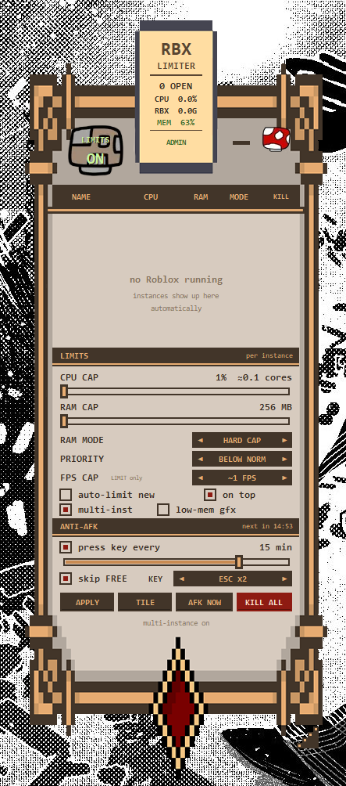

# RBX Limiter

A small Windows tool for running many Roblox accounts at once without melting your PC.
It limits CPU, RAM and FPS per instance, keeps your alts from being kicked for idling,
and tiles their windows, all from one pixel-art scroll.

> Not affiliated with or endorsed by Roblox Corporation. It does **not** inject into,
> read or modify Roblox's memory; it only uses normal Windows process and window
> controls. Running several clients and anti-AFK may still go against a game's rules
> or Roblox's Terms of Use, so use it at your own risk.

## Features

- **Instance list:** every running Roblox client with live CPU and RAM. Click a name to rename it.
  Names are saved per slot (#1, #2, ...) and shown in the Roblox window title.
- **Per-instance limits**, applied only to instances marked **LIMIT** (mark the one you play as **FREE**):
  - **CPU cap:** hard cap through a Windows Job Object, as a % of the whole CPU.
  - **RAM cap:** hard working-set cap, or a periodic trim.
  - **Priority:** Idle, Below normal or Normal.
  - **FPS cap:** 1 to 30 FPS, done by pausing and resuming the process. The window you're using is never paused.
- **Status that shows what's really in effect.** The labels read the real state back from Windows:
  LIMIT, PARTIAL, DENIED, FREE, or LOAD (a new instance's first 60 s, before the RAM cap and FPS cap kick in).
- **Anti-AFK:** every 1 to 19 minutes it presses ESC twice (or Space) in each instance, then gives your focus back.
- **TILE:** lays all limited instances out as small windows on any monitor, including rotated ones.
- **Low-mem graphics:** sets Roblox's own settings to lowest textures and graphics quality for all instances.
- **Multi-instance:** lets you open more than one Roblox client.
- **Memory gauge and crash reasons:** warns before Windows runs out of memory, and tells you why an instance closed (for example "out of memory").
- **Watchdog:** if the tool itself crashes, it un-freezes every instance and restarts. Errors go to `%APPDATA%\RBXLimiter\crash.log`.
- **Resizable:** drag the bottom-right grip, or use Ctrl + mouse wheel.

## Download

Grab `RBXLimiter.exe` from the [Releases](../../releases) page and run it. It asks for
administrator rights, which the RAM cap and some other limits need.

Windows may show a SmartScreen or antivirus warning because the exe isn't code-signed.
If you'd rather not trust a prebuilt exe, run it from source or build it yourself (below).

## Run from source

1. Install [Python 3](https://www.python.org/downloads/). It needs tkinter, which the python.org installer includes by default.
2. Download this repo, keeping `rbx_limiter.py` and `scroom_assets.py` together.
3. Double-click `run.bat` (or run `pythonw rbx_limiter.py`).

No `pip install` is needed; it only uses the standard library.

## Build the exe

| Script | Result |
|---|---|
| `build_nuitka.bat` | Smaller and lighter exe, compiled with Nuitka. The first build takes several minutes and downloads a C compiler by itself. It uses Python 3.14; change `WANT` in `build_nuitka.py` for another version. |
| `build_pyinstaller.bat` | Quick to build, a bit heavier to run. The output goes to `dist\RBXLimiter.exe`. |

## Tips for many accounts

- Launch accounts **one at a time**, about 15–20 s apart.
- Turn on **low-mem gfx** and use **TILE**. Small windows with low textures save the most memory.
- A RAM cap only moves memory out of RAM. Windows 11 compresses it but keeps it in RAM. To really
  free it, turn memory compression off (admin PowerShell: `Disable-MMAgent -MemoryCompression`,
  then restart) and give Windows a big pagefile.
- Keep an eye on **MEM** on the tag. Past about 90%, instances start crashing.

## How it works

| Feature | Windows mechanism |
|---|---|
| CPU cap | `JOBOBJECT_CPU_RATE_CONTROL_INFORMATION` with a hard cap, one named job per process |
| RAM cap | `SetProcessWorkingSetSizeEx` with `QUOTA_LIMITS_HARDWS_MAX_ENABLE` |
| FPS cap | `NtSuspendProcess` / `NtResumeProcess` slices, staggered across instances |
| Anti-AFK | focus the window, then `SendInput` scancodes |
| Low-mem gfx | Roblox `ClientAppSettings.json` flags and `GlobalBasicSettings` quality |
| Multi-instance | holds the `ROBLOX_singletonMutex` / `ROBLOX_singletonEvent` names |

All limits are removed again when you close the tool with the mushroom button.

## License

[MIT](LICENSE)
